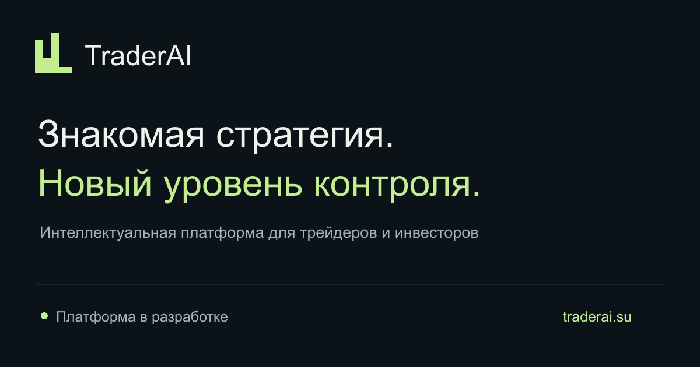
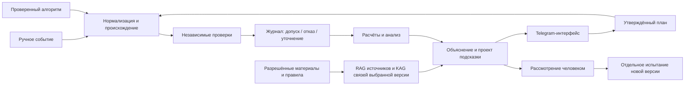

# TraderAI

### От понимания стратегии — к проверяемым решениям.

**TraderAI — разрабатываемый AI-ассистент для трейдера: от описания своей методики до проверки сигналов и разбора сделок.**

Этот публичный репозиторий — самостоятельный showcase: промосайт, интерактивная демонстрация, архитектурные материалы и тесты. Описание концепции актуализировано по согласованным ответам команды к заданиям 2–10 конкурса **«Инвест. Премаркет»**. Репозиторий не является пакетом конкурсной сдачи. Упоминание конкурса не означает партнёрство, поддержку или победу.

[Сайт](https://traderai.su/) · [Интерактивное демо](https://traderai.su/demo/) · [Материал для конкурса](docs/PREMARKET.md)

[Концепция платформы](docs/PRODUCT.md) · [Архитектура](docs/ARCHITECTURE.md) · [Безопасность](SECURITY.md) · [Запуск](#локальный-запуск)



## Зачем нужна платформа

Между объяснением трейдера и воспроизводимым решением много неявных шагов: понять термины, уточнить условия, проверить данные, рассчитать ограничения и зафиксировать результат. ИИ помогает работать с языком и контекстом; программные алгоритмы делают расчёты и проверки повторяемыми.

Трейдер сможет передать методику текстом, аудио, видео или скриншотами. Ассистент должен уточнить правила входа и выхода, мани- и риск-менеджмент и представить их на подтверждение. В фокусе MVP — собственная методика трейдера, её проверка и только paper/виртуальные сделки.

| Источник решения | Роль автора                      | Общие инструменты                   |
| ---------------- | -------------------------------- | ----------------------------------- |
| Ручная торговля  | Принимает решение сам            | Журнал, разбор, описание подхода    |
| Торговый план    | Утверждает условия и ограничения | Формализация, мониторинг, план/факт |
| Алгоритм         | Проверяет и утверждает версию    | Испытания, контроль допуска, анализ |

Ручная торговля не требует обязательного перехода на робота. Импорт истории не разрешает автоматически повторять сделки. Доступ к аналитике и допуск стратегии к исполнению — разные решения.

## Как знания превращаются в проверяемый процесс

1. **RAG и KAG каждой стратегии.** RAG ищет основания в разрешённых источниках выбранной методики и версии. KAG должен связывать правила, условия и события, сохраняя происхождение связей; вывод модели требует проверки человеком.
2. **Текст, речь и визуальные материалы.** Планируем обработку аудио, видео и скриншотов с привязкой к первоисточникам и таймкодам. Неразборчивые значения и неоднозначные правила требуют уточнения.
3. **ИИ-агенты.** Разделяем роли исследователя знаний, формализатора плана, наблюдателя и аналитика. Каждый работает в пределах своих инструментов; расчёты и риск остаются в программном слое.
4. **Telegram-бот.** Интерфейс для вопросов по методике, передачи и уточнения плана, статуса обработки видео, уведомлений и отчётов. Управление действиями требует проверки полномочий и предусмотренного подтверждения.
5. **Рыночный контекст и журнал plan/fact.** Сигнал рассматривается с учётом рыночного фона, характера инструмента, волатильности, точки входа, стопов и тейков. Журнал связывает план, проверки и фактический результат виртуальной сделки; код считает метрики и издержки.
6. **Рекомендации.** Проверяемое наблюдение превращается в исследовательскую гипотезу: уточнить условие, сравнить сценарии или способы выхода. Проект изменения не меняет активную стратегию.
7. **Испытания и риск.** Исторические эксперименты, раздельные периоды проверки, виртуальная торговля и независимый Risk Guard. Переход к новой версии требует проверки и решения человека.

Это план развития, а не перечень готовых функций. В этом репозитории реализованы только сайт и синтетическое демо; модели, RAG/KAG, бот и рыночные интеграции к ним не подключены. [Обзор со схемами на сайте](https://traderai.su/technology/) · [Актуальная архитектура и планируемые компоненты](docs/ARCHITECTURE.md).

## Что действительно работает здесь

- Статический русскоязычный сайт: 11 HTML-страниц, адаптивная вёрстка, локальная графика и метаданные.
- Браузерное демо: три источника, четыре учебные ситуации, общий журнал проверок.
- Разрешённый пример, отказ при превышении лимита, запрос уточнения и отказ при отсутствии источника.
- Создание проекта подсказки **без изменения активной версии**.
- Автоматические проверки типов, поведения демо, опубликованных файлов и браузерных сценариев.
- Локальные шрифты, оригинальные иллюстрации и короткие анимации с поддержкой уменьшения движения; [источники графики](docs/VISUAL-ASSETS.md).

Числа, события и идентификаторы `DEMO-*` придуманы для демонстрации. Это не реальные рыночные данные, торговая методика или результаты инвестирования. Настоящая модель не генерирует текст в демо.

**В этом репозитории нет** торгового исполнения, брокерских адаптеров, пользовательских счетов, платежей, сбора заявок, производственных стратегий, промптов, журналов и материалов авторов. Код создан независимо; история рабочего проекта не импортировалась.

## Архитектура



Это логическая схема, не требование множества микросервисов. В публичном демо путь завершается учебным журналом. В планируемом MVP — только виртуальное исполнение после независимого Risk Guard; LLM не управляет лимитами. Утверждение правил и их изменений остаётся за человеком.

## Технологии

| Область                | Выбор                                         | Статус                 |
| ---------------------- | --------------------------------------------- | ---------------------- |
| Публичный сайт         | Astro, TypeScript, CSS                        | Реализовано здесь      |
| Синтетическое демо     | Чистые функции, неизменяемые события          | Реализовано здесь      |
| Проверки               | Node test runner, Astro Check, Playwright     | Реализовано здесь      |
| Размещение             | Статические файлы, существующий reverse proxy | Шаблон в `deploy/`     |
| Прикладной API         | Python, FastAPI                               | План MVP               |
| Сложные задачи         | DeepSeek Harness + DeepSeek-V4.1-Flash        | Планируемые компоненты |
| Оперативный анализ     | Локальная Qwen3.5-4B                          | Планируемый компонент  |
| Речь и визуальный ввод | WhisperKit/faster-whisper, Qwen3.8-Omni-Flash | Планируемые компоненты |
| Знания и журнал        | RAG/KAG, LanceDB, PostgreSQL                  | План MVP               |
| Рабочие интерфейсы     | Telegram и веб-интерфейс                      | План MVP               |
| Рынок и история        | T-Invest MCP/Open API, только чтение данных   | План MVP               |

Названия моделей и инструментов отражают план команды; доступность конкретных
версий, лицензии, совместимость и стоимость ещё требуют проверки. Это не зависимости сайта.

Полноценные модели и брокерские подключения не нужны для запуска showcase. Точные зависимости закреплены в `package-lock.json`; причины решений — в [ADR](docs/DECISIONS.md).

## Локальный запуск

Node.js **22.22.0+**, npm 9.6.5+. Проверенная версия Node: `.nvmrc`.

```sh
npm ci --ignore-scripts
npm run dev
```

Открыть `http://127.0.0.1:4321`. Секреты и `.env` не требуются.

```sh
npm run verify
npm run test:e2e
```

Для браузерных тестов нужен Chromium: `npx playwright install chromium`. Если установлен Google Chrome, можно использовать `PLAYWRIGHT_CHANNEL=chrome npm run test:e2e` без загрузки дополнительного браузера.

```sh
npm run build
npm run preview
```

Публикуется **только `dist/`**. Сайт не требует Node.js на сервере. Настройка домена и безопасное размещение: [DEPLOYMENT.md](docs/DEPLOYMENT.md).

## Навигация по коду

```text
src/content/       публичные тексты
src/components/    интерфейс и оригинальная SVG-графика
src/pages/         статические маршруты, sitemap и robots
src/demo/          независимое синтетическое демо
tests/             unit- и браузерные проверки
scripts/           аудит выходной сборки
docs/              продукт, архитектура, конкурс, решения
deploy/            шаблон отдельного сайта для Caddy
```

## Границы и следующий этап

Сейчас — `public_static`. Ранний доступ, подтверждение email, кабинеты, каталог стратегий, брокерские интеграции и реальные испытания требуют отдельных решений. Сайт не имитирует принятие заявки.

Результаты тестирования не гарантируют доходности. Инвестиции связаны с риском потери капитала.

Контакт инициатора: [Telegram @Eduard_KHV](https://t.me/Eduard_KHV) · [lred@list.ru](mailto:lred@list.ru) · +7 981 173‑03‑95.

**Права:** open-source лицензия пока не выбрана владельцем. Публичная доступность не означает выдачу лицензии MIT, Apache или GPL. См. [NOTICE.md](NOTICE.md). Не отправляйте секреты и реальные торговые материалы в issues.

Существующая ИС, TraderAI Core, его исходники, приватные спецификации, торговые
алгоритмы, промпты и секреты исключены из конкурсной поставки. Публикация этих
описаний не разрешает их перенос или лицензирование. Состав направляемых Работ
определяется отдельно с учётом п. 8.8; оговорка в README не изменяет правила
конкурса. [Границы материалов и прав](docs/PREMARKET.md#границы-материалов-и-прав).
