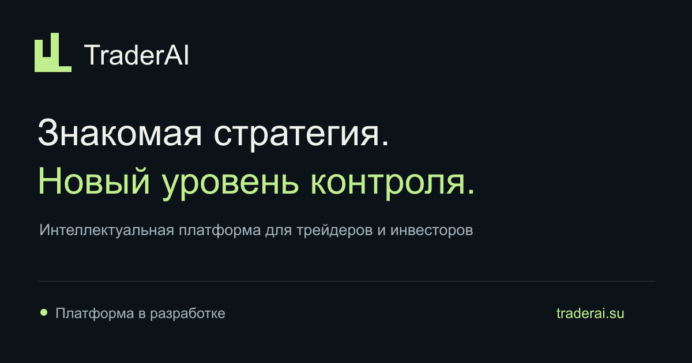
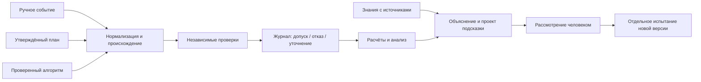

# TraderAI

### От понимания стратегии — к проверяемым решениям.

**TraderAI — разрабатываемая интеллектуальная платформа анализа и автоматизации биржевой торговли для трейдеров и инвесторов.**

Этот публичный репозиторий — самостоятельный showcase: промосайт, интерактивная демонстрация, архитектурные материалы и тесты. Подготовлен для представления концепции на конкурсе **«Премаркет» Т‑Банка Инвестиции**. Упоминание конкурса не означает партнёрство, поддержку или победу.

[Сайт](https://traderai.su/) · [Интерактивное демо](https://traderai.su/demo/) · [Материал для конкурса](docs/PREMARKET.md)

[Концепция платформы](docs/PRODUCT.md) · [Архитектура](docs/ARCHITECTURE.md) · [Безопасность](SECURITY.md) · [Запуск](#локальный-запуск)



## Зачем нужна платформа

Между объяснением трейдера и воспроизводимым решением много неявных шагов: понять термины, уточнить условия, проверить данные, рассчитать ограничения и зафиксировать результат. ИИ помогает работать с языком и контекстом; программные алгоритмы делают расчёты и проверки повторяемыми.

Для инвестора цель — выбирать авторский подход, понимать условия и в будущем подключать разрешённое исполнение через брокерскую инфраструктуру. Для автора — сохранять привычный способ торговли и получать единые инструменты анализа, формализации и проверки гипотез.

| Источник решения | Роль автора                      | Общие инструменты                   |
| ---------------- | -------------------------------- | ----------------------------------- |
| Ручная торговля  | Принимает решение сам            | Журнал, разбор, описание подхода    |
| Торговый план    | Утверждает условия и ограничения | Формализация, мониторинг, план/факт |
| Алгоритм         | Проверяет и утверждает версию    | Испытания, контроль допуска, анализ |

Ручная торговля не требует обязательного перехода на робота. Импорт истории не разрешает автоматически повторять сделки. Доступ к аналитике и допуск стратегии к исполнению — разные решения.

## Три исследовательских направления

1. **ИИ и торговый план.** Перевод естественного языка в уточняемые условия, сопоставление с рыночными данными, объяснение сигналов.
2. **Video RAG.** Транскрибация разрешённых материалов, семантическая индексация, гибридный поиск и ответы с проверяемыми первоисточниками и таймкодами.
3. **Испытания и риск.** Исторические эксперименты, виртуальная торговля, независимые проверки и журналирование решений.

Исследовательские прототипы являются основой концепции. Они не означают готовность публичных кабинетов, брокерского подключения или платной услуги.

## Что действительно работает здесь

- Статический русскоязычный сайт: 11 HTML-страниц, адаптивная вёрстка, локальная графика и метаданные.
- Браузерное демо: три источника, четыре учебные ситуации, общий журнал проверок.
- Разрешённый пример, отказ при превышении лимита, запрос уточнения и отказ при отсутствии источника.
- Создание проекта подсказки **без изменения активной версии**.
- Автоматические проверки типов, поведения демо, опубликованных файлов и браузерных сценариев.

Числа, события и идентификаторы `DEMO-*` придуманы для демонстрации. Это не реальные рыночные данные, торговая методика или результаты инвестирования. Настоящая модель не генерирует текст в демо.

**В этом репозитории нет** торгового исполнения, брокерских адаптеров, пользовательских счетов, платежей, сбора заявок, производственных стратегий, промптов, журналов и материалов авторов. Код создан независимо; история рабочего проекта не импортировалась.

## Архитектура



Это логическая схема, не требование множества микросервисов. В публичном демо путь завершается учебным журналом. Реальные действия в исследовательском контуре требуют Risk Guard и ручного подтверждения; LLM не получает прямого доступа к исполнению.

## Технологии

| Область               | Выбор                                               | Статус                    |
| --------------------- | --------------------------------------------------- | ------------------------- |
| Публичный сайт        | Astro, TypeScript, CSS                              | Реализовано здесь         |
| Синтетическое демо    | Чистые функции, неизменяемые события                | Реализовано здесь         |
| Проверки              | Node test runner, Astro Check, Playwright           | Реализовано здесь         |
| Размещение            | Статические файлы, существующий reverse proxy       | Шаблон в `deploy/`        |
| Исследовательский API | Python, FastAPI, Pydantic                           | Архитектурное направление |
| Знания                | FFmpeg, ASR, embeddings, LanceDB, optional reranker | Архитектурное направление |
| Журнал и эксперименты | SQLite, воспроизводимые вычисления                  | Архитектурное направление |

Полноценные модели и брокерские подключения не нужны для запуска showcase. Точные зависимости закреплены в `package-lock.json`; причины решений — в [ADR](docs/DECISIONS.md).

## Локальный запуск

Node.js **22.22.0+**, npm 9.6.5+. Проверенная версия Node: `.nvmrc`.

```sh
npm ci --ignore-scripts
npm run dev
```

Открыть `http://127.0.0.1:4321`. Секреты и `.env` не требуются.

```sh
npm run verify
npm run test:e2e
```

Для браузерных тестов нужен Chromium: `npx playwright install chromium`. Если установлен Google Chrome, можно использовать `PLAYWRIGHT_CHANNEL=chrome npm run test:e2e` без загрузки дополнительного браузера.

```sh
npm run build
npm run preview
```

Публикуется **только `dist/`**. Сайт не требует Node.js на сервере. Настройка домена и безопасное размещение: [DEPLOYMENT.md](docs/DEPLOYMENT.md).

## Навигация по коду

```text
src/content/       публичные тексты
src/components/    интерфейс и оригинальная SVG-графика
src/pages/         статические маршруты, sitemap и robots
src/demo/          независимое синтетическое демо
tests/             unit- и браузерные проверки
scripts/           аудит выходной сборки
docs/              продукт, архитектура, конкурс, решения
deploy/            шаблон отдельного сайта для Caddy
```

## Границы и следующий этап

Сейчас — `public_static`. Ранний доступ, подтверждение email, кабинеты, каталог стратегий, брокерские интеграции и реальные испытания требуют отдельных решений. Сайт не имитирует принятие заявки.

Результаты тестирования не гарантируют доходности. Инвестиции связаны с риском потери капитала.

Контакт инициатора: [Telegram @Eduard_KHV](https://t.me/Eduard_KHV) · [lred@list.ru](mailto:lred@list.ru) · +7 981 173‑03‑95.

**Права:** open-source лицензия пока не выбрана владельцем. Публичная доступность не означает выдачу лицензии MIT, Apache или GPL. См. [NOTICE.md](NOTICE.md). Не отправляйте секреты и реальные торговые материалы в issues.
